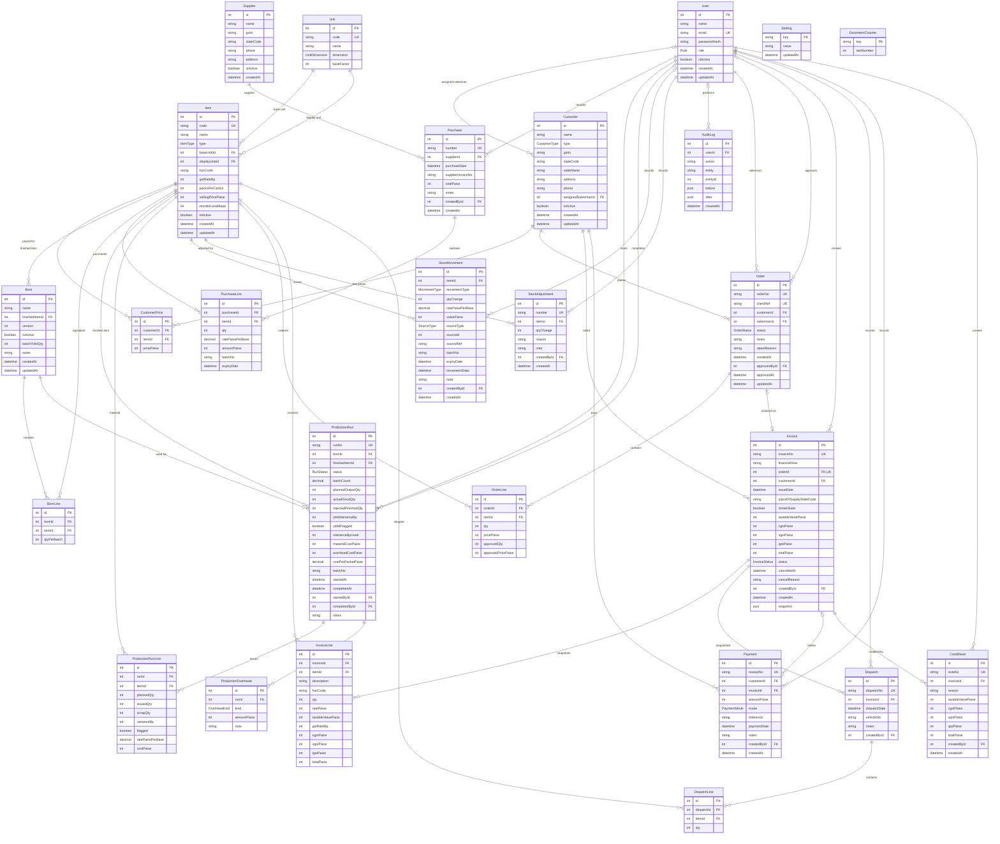

# Data Model

## Production run cost allocation

All overheads for a run are charged fully to that run; each run produces one finished product.
Total run cost in paise = `materialCostPaise + overheadCostPaise`.
Cost per good packet = total run cost / `actualGoodQty`, rounded half-up to four decimal places.
Scrap and damaged packets carry cost but are excluded from the good-quantity divisor.
Overhead entries do not create stock movements; deletions retain an audit record.

Money is stored as integer paise to avoid floating-point rounding in financial values.
List prices and customer-specific prices use the same integer-paise representation.
Quantities are stored as integer base units such as grams, millilitres, pieces, or packets.
`Unit.baseFactor` converts displayed units to integer base units at the system boundary.
This keeps inventory arithmetic and financial totals deterministic and auditable.

Stock = sum of ledger rows; production run writes ISSUE rows (raw down) and OUTPUT row (finished up).
Each stock movement records a signed quantity in the item's integer base unit.
The movement source identifies the originating business document for traceability.
Stock movements are append-only: a PostgreSQL trigger rejects UPDATE and DELETE; corrections use a new ADJUSTMENT movement.
Each adjustment has a numbered source record so its append-only ledger row is traceable.
A bill of materials records the ingredients and base-unit quantities for one batch.
Purchases and production runs retain their line-level quantities, rates, and costs.
Audit logs capture who changed an entity and the recorded before-and-after values.

## Sales model notes

- Invoice lines snapshot their rate, HSN code, and GST rate so later master-data changes do not alter posted invoices.
- Cancelling an invoice creates a credit note; invoices are never deleted.
- The invoice snapshot stores seller, buyer, and originating order details as JSON. Database triggers prevent invoice and invoice-line deletion, prevent invoice-line updates, and restrict invoice updates to cancellation fields until cancelled.
