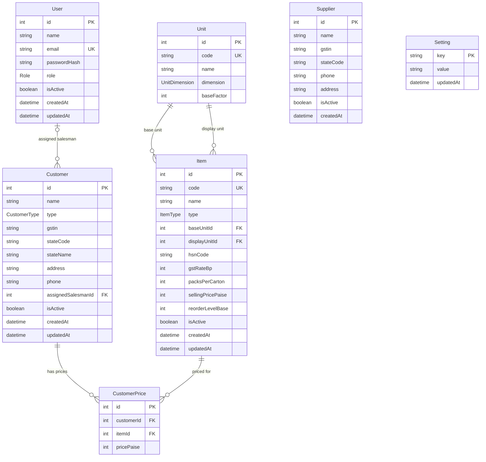

# Data Model

Money is stored as integer paise to avoid floating-point rounding in financial values.
List prices and customer-specific prices use the same integer-paise representation.
Quantities are stored as integer base units such as grams, millilitres, pieces, or packets.
`Unit.baseFactor` converts displayed units to integer base units at the system boundary.
This keeps inventory arithmetic and financial totals deterministic and auditable.
